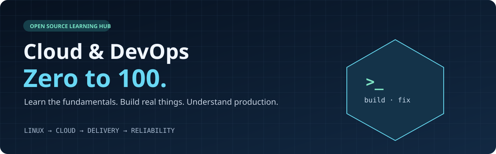
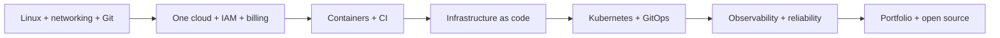

**Your starting point for cloud, DevOps, and the habits that make you a better engineer.**

[Start here](START-HERE.md) · [100-day roadmap](roadmap/100-days.md) · [Resource library](resources/README.md) · [Build projects](projects/README.md) · [Video companion](video/README.md)

## From saved links to skills you can demonstrate

You do not need to learn every cloud service or collect another hundred tutorials. You need a sensible order, trustworthy references, and projects that force you to understand what happens when things break.

This is a curated learning hub by [Aniket Singh](https://github.com/aniketsingh1023), inspired by the habits in **“10-10 Habits to Get Ridiculously Good at Tech.”** It brings together official documentation, open-source repositories, engineering blogs, research papers, and original practice prompts.

**Pick one resource. Build one thing. Break it safely. Explain the fix. Repeat.**

## Choose your entry point

| If this sounds like you | Start with | Leave with |
|---|---|---|
| “I’m new to Linux and cloud.” | [Start here](START-HERE.md), then days 1–20 | A working terminal workflow and a request-flow diagram |
| “I keep watching tutorials.” | [Local build-and-break lab](labs/build-break-fix/README.md) | A service you can run, diagnose, and recover |
| “I know the tools but need direction.” | [100-day roadmap](roadmap/100-days.md) | A sequence of practical deliverables |
| “I want a portfolio.” | [Eight project briefs](projects/README.md) | Architecture, code, evidence, and a runbook |
| “I want to think like an engineer.” | [Habits from the video](video/README.md) | An active reading and experimentation routine |

## The learning path

Security, documentation, cost awareness, and fundamentals run through every stage. “100 days” is a suggested practice schedule; mastery and job outcomes are not guaranteed by a calendar.

## From my GitHub stars

This edition also includes **22 selected repositories from my public stars**, including DevOps cheatsheets, project collections, Terraform courses, Kubernetes examples, system-design reading and optional AI/MLOps material. [Browse the selections and why they fit](docs/starred-picks.md).

## Explore the library

| Area | What you will practice |
|---|---|
| [Foundations](resources/foundations.md) | Linux, processes, DNS, HTTP, networking |
| [Git & code](resources/git-and-code.md) | Version control, Python, shell automation |
| [Cloud](resources/cloud.md) | AWS, Azure, Google Cloud, IAM, cost controls |
| [Containers](resources/containers.md) | Docker, Compose, Kubernetes, Helm |
| [Infrastructure as code](resources/infrastructure-as-code.md) | Terraform, OpenTofu, Ansible, policy checks |
| [Delivery](resources/delivery.md) | CI/CD, GitHub Actions, GitOps, releases |
| [Observability & SRE](resources/observability-and-sre.md) | Metrics, logs, traces, SLOs, recovery |
| [Security & cost](resources/security-and-cost.md) | Secrets, image scans, supply chain, FinOps |
| [Architecture](resources/architecture.md) | Caching, queues, databases, system design |
| [Engineering blogs](resources/engineering-blogs.md) | Production decisions and tradeoffs |
| [Outage stories](resources/outage-stories.md) | Timelines, contributing factors, prevention |
| [Papers](resources/papers.md) | Distributed systems; optional AI reading |
| [Open source & people](resources/open-source-and-people.md) | Source reading, contribution, active learning |
| [Community projects](resources/community-projects.md) | Selected AWS, EKS, GKE and CI/CD implementations |
| [Optional AI & MLOps](resources/ai-and-mlops.md) | AI-assisted operations and deployment learning |

Every entry includes **level, format, access/cost notes, why it matters, and something to do with it**. [Search the catalog locally](resources/README.md#search-locally) when you have a specific question.

## Build instead of only bookmarking

1. Run the [dependency-free Python lab](labs/build-break-fix/README.md).
2. Work through [eight progressively harder projects](projects/README.md).
3. Keep a [learning log](templates/learning-log.md), an [architecture decision](templates/architecture-decision.md), and an [incident review](templates/postmortem.md).
4. Revisit the [glossary](GLOSSARY.md) and [fundamentals questions](practice/fundamentals.md).

## What comes from the video?

The [timestamped companion](video/README.md) maps the video’s advice to exercises and resources. Netflix, Google, Cloudflare, the June 21, 2022 Cloudflare outage, research reading, open source, and revisiting fundamentals appear in the video. The wider resource collection and roadmap are editorial additions. The AI examples are optional.

## Keep it useful

- **Readers:** star it if it helps, fork it for your progress, and share what you built.
- **Contributors:** suggest a resource with an original explanation and a practical task. Read [CONTRIBUTING.md](CONTRIBUTING.md).
- **Maintainers:** [MAINTENANCE.md](MAINTENANCE.md) explains catalog generation, link checks and review standards.

This repository’s original writing and code use the [MIT license](LICENSE). Linked resources keep their own licenses and terms; they are attributed to their authors and are not rehosted here. Resource availability, lab access, prices, and service features can change. Check the linked source before spending money.
